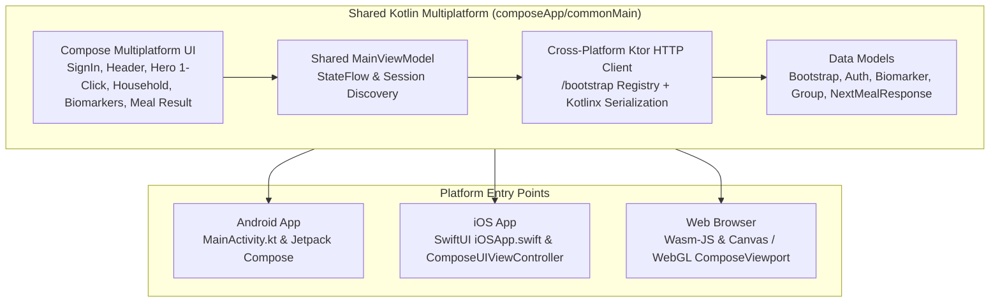

# SortMyPlate KMP (Kotlin Multiplatform Client)

> **Cross-Platform Compose Multiplatform Frontend for Android, iOS, and Web (Wasm)**

This project provides a single unified Kotlin codebase delivering native performance and 100% shared UI/logic across **Android**, **iOS**, and **Web (Wasm-JS)** connected to the live cloud backend at **`https://j6tgemptpq36.ramnaymcloud.com`**.

---

## Dynamic Endpoint Discovery Architecture

Frontends **do not hardcode API endpoint routes**. Instead:
1. On startup, `MainViewModel.bootstrapSession()` calls **`GET https://j6tgemptpq36.ramnaymcloud.com/bootstrap`**.
2. `SortMyPlateApi` stores the returned `base_url` and `endpoints` registry in session memory.
3. All subsequent calls — Google Sign-In (`auth_google`), biomarkers (`biomarkers_latest`, `biomarkers_record`), groups (`groups_my`, `groups_create`, `groups_join`, `groups_leave`), LLM health (`llm_status`), and meal generation (`meals_next`) — resolve dynamically from the discovered session registry.

---

## Architecture Overview



---

## Network Inspector Tooling

A full cross-platform **Network Inspector** is built into the KMP networking stack:

1. **In-App KMP Network Inspector (`📡 Net (N)` Pill in Header)**:
   - Implemented in [`NetworkInspector.kt`](composeApp/src/commonMain/kotlin/io/sortmyplate/network/NetworkInspector.kt) via a pure Ktor `createClientPlugin` + `ResponseObserver` (`ktor-client-core`) and rendered via [`NetworkInspectorView.kt`](composeApp/src/commonMain/kotlin/io/sortmyplate/ui/NetworkInspectorView.kt).
   - Works identically across **Android, iOS, and Web (Wasm-JS)**.
   - Displays every HTTP transaction (`/bootstrap`, Google Sign-In, biomarkers, groups, `/meals/next`), status code, latency (`ms`), headers (with `Authorization: Bearer` tokens redacted), pretty-printed JSON request/response bodies, and network failures.
2. **IDE & Native DevTools Support**:
   - **Android**: [`PlatformConfig.android.kt`](composeApp/src/androidMain/kotlin/io/sortmyplate/network/PlatformConfig.android.kt) explicitly uses the **OkHttp** Ktor engine so **Android Studio -> App Inspection -> Network Inspector** captures all traffic automatically.
   - **iOS**: [`PlatformConfig.ios.kt`](composeApp/src/iosMain/kotlin/io/sortmyplate/network/PlatformConfig.ios.kt) uses **Darwin (`NSURLSession`)** + console logging (`[KMP-NET]`).
   - **Web (Wasm-JS)**: [`PlatformConfig.wasmJs.kt`](composeApp/src/wasmJsMain/kotlin/io/sortmyplate/network/PlatformConfig.wasmJs.kt) uses Browser **Fetch (`Js`)** visible in Browser DevTools (`Network` & `Console`).

---

## How to Run

No local backend setup is required — all platform targets connect directly to **`https://j6tgemptpq36.ramnaymcloud.com`**.

### 1. Run Web (Compose Multiplatform Wasm)
```bash
./gradlew wasmJsBrowserDevelopmentRun
```

### 2. Run Android
Open the `kmp` folder in **Android Studio** (Ladybug or newer) and click **Run**, or from the terminal:
```bash
./gradlew installDebug
```

### 3. Run iOS
Open `kmp/iosApp` in **Xcode** and click **Run** (supports iOS Simulator and physical devices).
