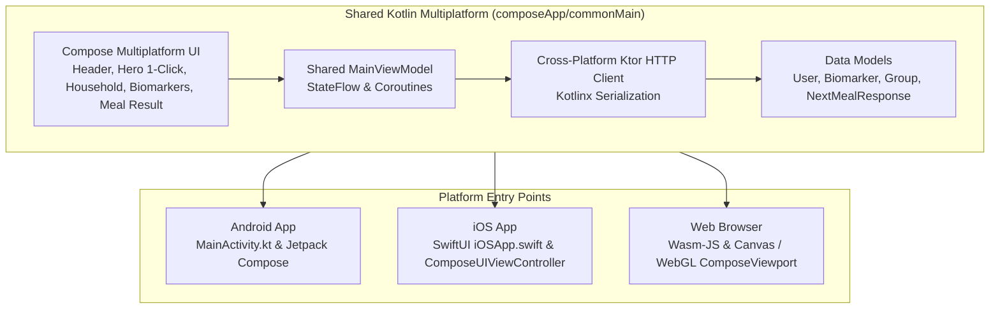

# SortMyPlate KMP (Kotlin Multiplatform Client)

> **Cross-Platform Compose Multiplatform Frontend for Android, iOS, and Web (Wasm)**

This project provides a single unified Kotlin codebase delivering native performance and 100% shared UI/logic across **Android**, **iOS**, and **Web (Wasm-JS)**.

---

## Architecture Overview



### Key Shared Components:
- **Shared Compose UI**: Single implementation of the 1-click "Next Meal" hero button, the dynamic flatmate selector chips, the encrypted 6-month blood panel viewer, and the explainable clinical reasoning cards.
- **Ktor Client 3.x**: Cross-platform networking engine with native bindings:
  - Android: `OkHttp`
  - iOS: `Darwin` (NSURLSession)
  - Web: `Js` (Fetch API)
- **Shared State Management**: `MainViewModel` powered by Kotlin `StateFlow` and Coroutines, lifecycle-aware across mobile and browser.

---

## How to Run

Ensure the backend is running first:
```bash
cd ../backend
source .venv/bin/activate
uvicorn app.main:app --reload --port 8000
```

### 1. Run Web (Compose Multiplatform Wasm)
```bash
./gradlew wasmJsBrowserDevelopmentRun
```
Opens in your browser with high-performance Canvas/WebGL rendering.

### 2. Run Android
Open the `kmp` folder in **Android Studio** (Ladybug or newer) and click **Run**, or from the terminal:
```bash
./gradlew installDebug
```
*(Note: Android emulator connects to your Mac host machine using `http://10.0.2.2:8000/v1`).*

### 3. Run iOS
Open `kmp/iosApp` in **Xcode** and click **Run** (supports iOS Simulator and physical devices).
